<!--
  ════════════════════════════════════════════════════════
   DESIGN TOKENS — manga panel issue
   paper     #F7F4EC   ink #141414   screentone #9A9A9A
   accent    red #D42A1E (stamps · SFX · chapter slashes only)
   icons     skillicons.dev full-color · shields for the long tail
   motion    focus lines breathe · chapter swipe · page flip · SFX shake
   assets    ./assets/*.svg — self-contained, animations always on
  ════════════════════════════════════════════════════════
-->

<!-- ═══════════════ COVER ═══════════════ -->

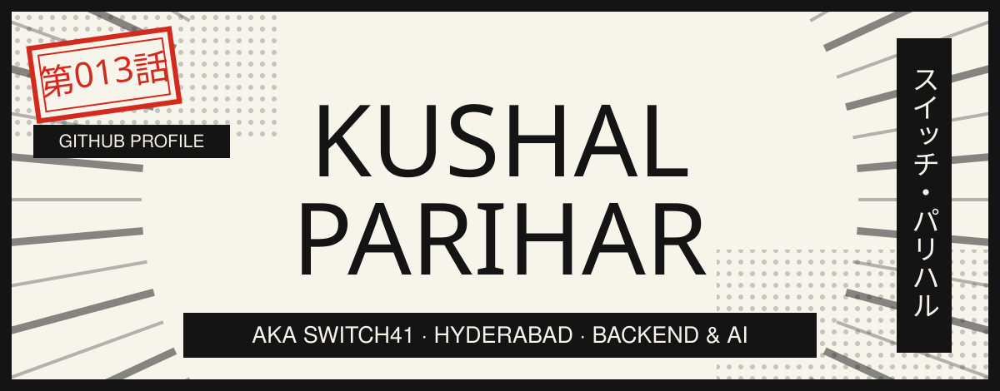

  

  <a href="https://switch41.kushalparihar013.workers.dev/">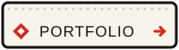</a>
  <a href="https://www.linkedin.com/in/kushal-parihar/">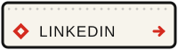</a>
  <a href="mailto:kushalparihar013@gmail.com">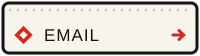</a>

  

<!-- ═══════════════ 第1話 — ABOUT ═══════════════ -->

## About

I'm a software engineer from **VBIT, Hyderabad**, working where **backend systems**, **applied AI**, and **full-stack** meet. I take vague ideas and push them all the way to something people can actually click — prototypes, hackathon builds, and the occasional very unnecessary rabbit hole.

Previously an **AI Developer Intern at Deephash Technologies** — FastAPI services, a RAG pipeline over Qdrant + AWS S3, Docker/Nginx in front, and a 26-case test suite keeping it honest.

  

<!-- ═══════════════ 第2話 — NOW ═══════════════ -->

## Now

<table border="3">
  <tr><td width="28%"><b>💼 Was</b></td><td>AI Developer Intern at Deephash Technologies — RAG, FastAPI, Docker </td></tr>
  <tr><td><b>🔍 Building</b></td><td>Privacy, healthcare and multilingual-AI tools</td></tr>
  <tr><td><b>🧩 Practicing</b></td><td>DSA in Python · system design </td></tr>
  <tr><td><b>🎯 Looking for</b></td><td>SDE &amp; AI/ML engineer roles</td></tr>
  <tr><td><b>🎮 Off-duty</b></td><td>Gamer, hackathon regular, dark-mode purist</td></tr>
</table>

<!-- ═══════════════ 第3話 — SELECTED WORK ═══════════════ -->

## Selected work

<table border="3">
  <tr>
    <td width="50%" valign="top">
      <h3>🛡️ Argus</h3>
      
Tourist safety platform — SOS broadcast, geofenced alerts, live tactical dashboard, and Fabric-backed digital IDs.

      
 <code>Fabric</code>

      <a href="https://argus-beryl.vercel.app/">Live demo →</a> ·
      <a href="https://github.com/switch41/Argus">Repo →</a>
    </td>
    <td width="50%" valign="top">
      <h3>🌐 Bhasha AI Lab</h3>
      
Multilingual dataset prep and LLM fine-tuning for low-resource Indian languages — dedup, BLEU eval, 194 automated tests.

      
  

      <a href="https://github.com/switch41/Bhasha-AI-lab-Stage-2-">Repo →</a>
    </td>
  </tr>
  <tr>
    <td width="50%" valign="top">
      <h3>🛡️ Smart Consent Manager</h3>
      
Audits any URL for cookies and third-party trackers, grades privacy A+ to F, and reads policies with Gemini.

      
 

      <a href="https://github.com/switch41/Smart-Consent-Manager">Repo →</a>
    </td>
    <td width="50%" valign="top">
      <h3>🏥 switch_healthcare</h3>
      
AI health assistant — symptom guidance, vitals tracking, patient records, interactive dashboards.

      

      <a href="https://github.com/switch41/switch_healthcare">Repo →</a>
    </td>
  </tr>
  <tr>
    <td width="50%" valign="top">
      <h3>🕵️ Redact</h3>
      
Detects and redacts personal data from documents using NLP and OCR.

      
  

      <a href="https://github.com/switch41/Redact">Repo →</a>
    </td>
    <td width="50%" valign="top">
      <h3>🔮 Prediction Market</h3>
      
Decentralized event forecasting built on Ethereum smart contracts.

      
 <code>Web3.js</code> <code>Ganache</code>

      <a href="https://github.com/switch41/prediction-market">Repo →</a>
    </td>
  </tr>
</table>

  <a href="https://github.com/switch41?tab=repositories">All 16 repositories →</a>

<!-- ═══════════════ 第4話 — STACK ═══════════════ -->

## Stack

  <b>Languages</b>

  

  <b>Frameworks &amp; libraries</b>

  

  <b>Data &amp; infrastructure</b>

  

  <b>AI &amp; tooling</b>

  
   
  
  
  
  
  
  

<!-- ═══════════════ 第5話 — RECOGNITION ═══════════════ -->


## Recognition

<table border="3">
  <tr>
    <td width="50%"><b>Smart India Hackathon</b> Team Lead, <i>Team Rookie</i> — 2nd of 100 teams (2025), top-20 shortlist (2024)</td>
    <td width="50%"><b>GDG on Campus Solution Challenge</b> Backend Lead, <i>Team Fourleaf</i> — 2025 &amp; 2026</td>
  </tr>
  <tr>
    <td width="50%"><b>NxtWave × OpenAI Buildathon</b> Stage 1 win → state-level Stage 2 with <i>Bhasha AI Lab</i></td>
    <td width="50%"><b>Swoparnika-2K23</b> Runner-up, VBIT technical competition</td>
  </tr>
</table>

<table border="3" width="92%" align="center">
  <tr><td align="center"><b>Also:</b> IBM SkillBuild, 1M1B, Geenovate, and more college hackathons than I should admit.</td></tr>
</table>

<!-- ═══════════════ PAGE TURN ═══════════════ -->

<a href="#fool1">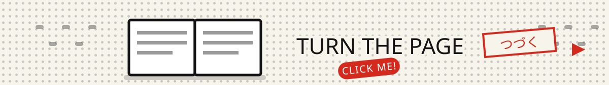</a>

<a href="#fool2"></a>


<!-- ═══════════════ 第6話 — ACTIVITY ═══════════════ -->

## Activity

  
  

  

<!-- Snake contribution graph: re-enable AFTER snake-workflow.yml runs once and creates the `output` branch.

  <picture>
    <source media="(prefers-color-scheme: dark)" srcset="https://raw.githubusercontent.com/switch41/switch41/output/github-snake-dark.svg" />
    
  </picture>

-->

<!-- ═══════════════ 第7話 — BEYOND CODE ═══════════════ -->


## Beyond code

- Gamer at heart — if it has a lobby, I have an opinion about it
- Hackathon regular: four shipped, one prize shelf
- Dark mode everywhere, including things that don't support dark mode
- Weekend rule: learn one new thing, break it properly, write down why

  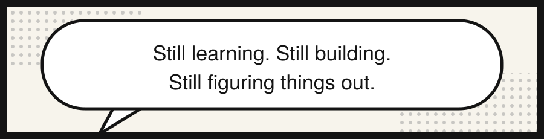

  <b>If it's fun, I'll probably build it. If it's challenging, I'm already sketching it out. If it's meaningful, I'll lose sleep over it.</b>

  Let's build something that matters — or at least something that makes you go, “Whoa, that's cool.”

<!-- ═══════════════ END PANEL ═══════════════ -->

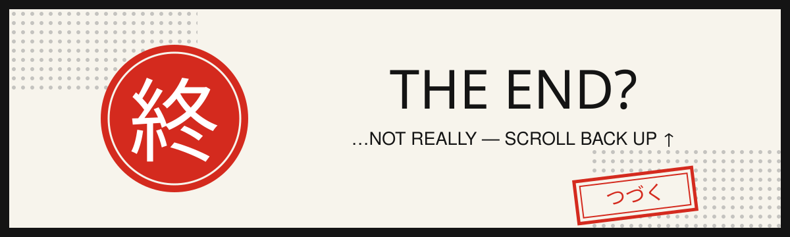

